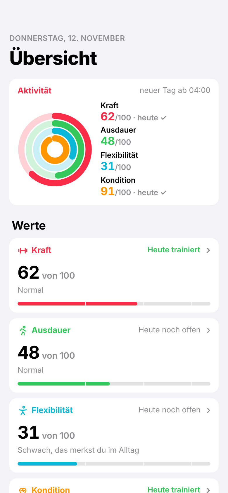
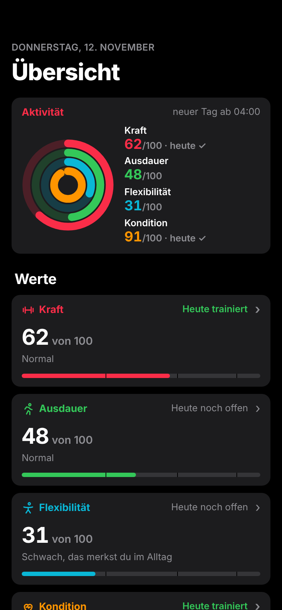
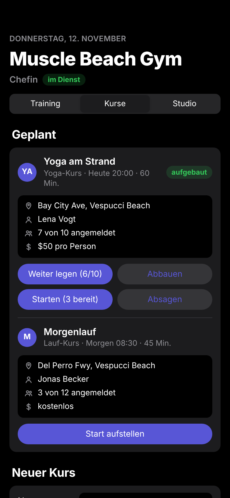
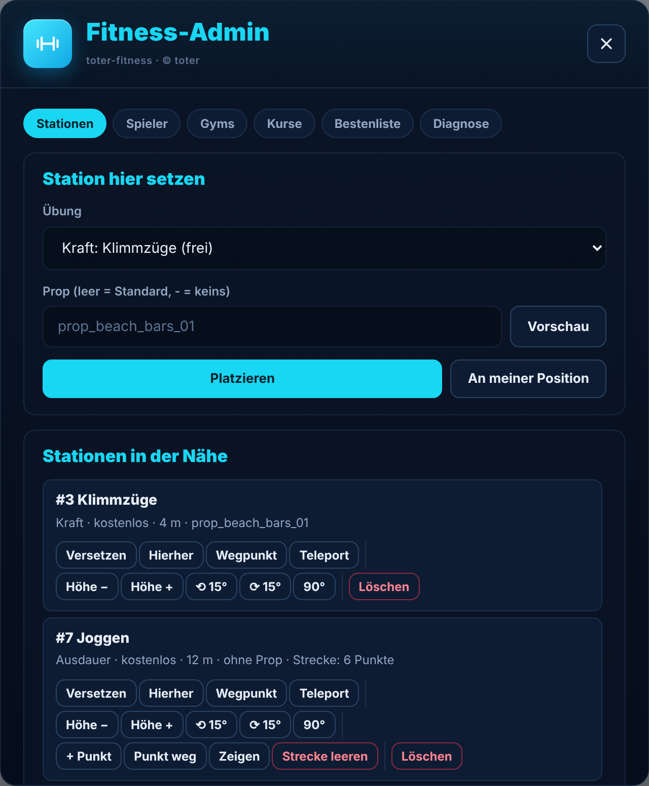
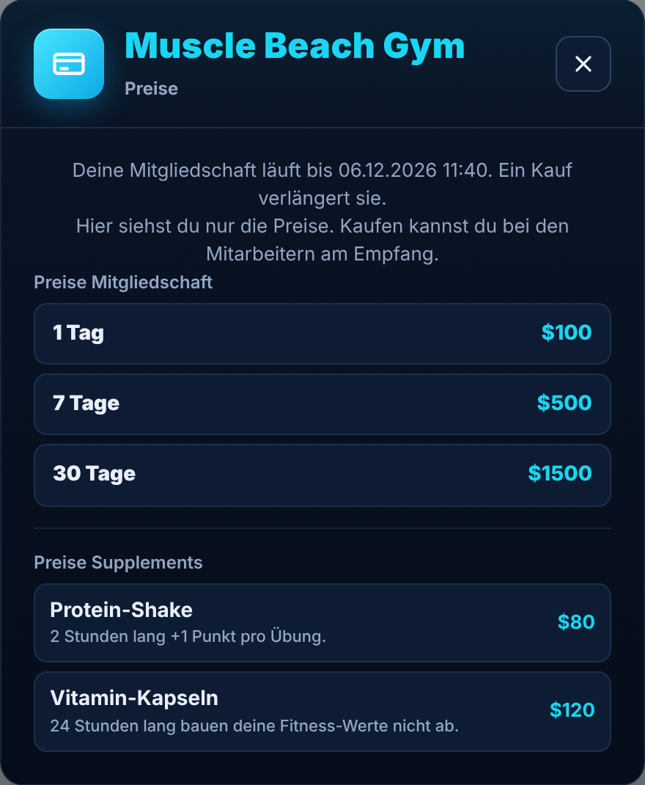
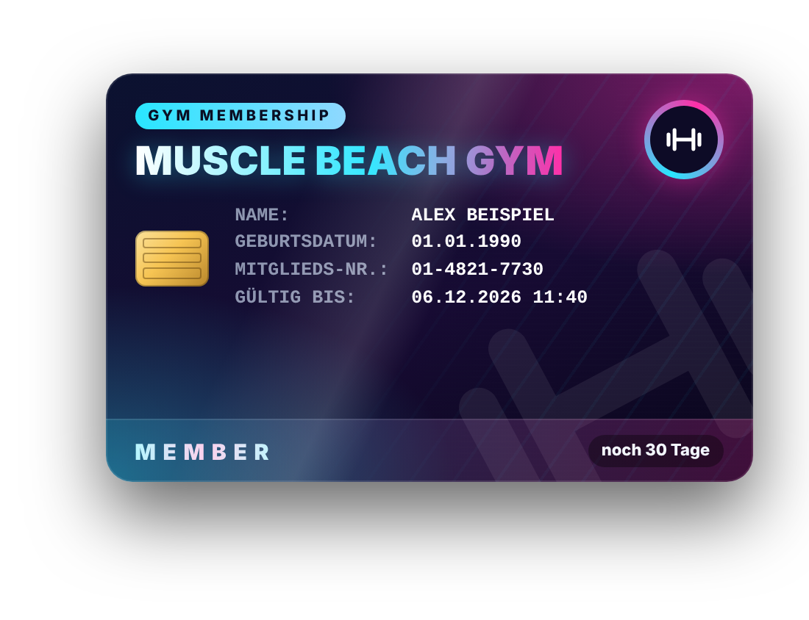
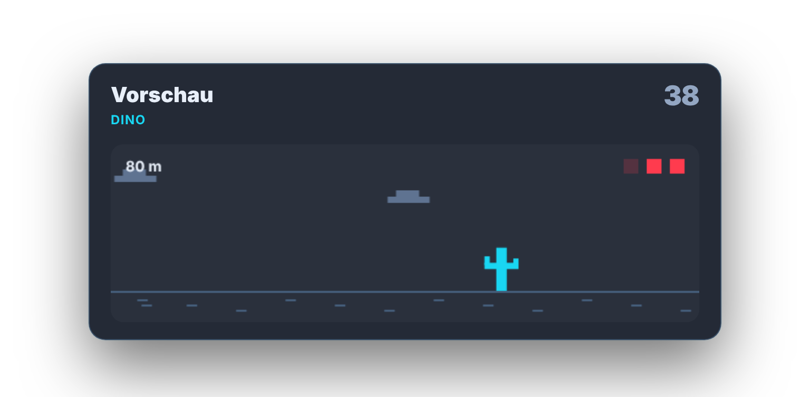

<div align="center">

# toter-fitness

**Fitness-System für FiveM: Training mit Minispielen, Gyms, Kurse, Personal Trainer und zwei Handy-Apps.**


  

</div>

> **English:** A fitness system for FiveM written in C#. Players train strength, stamina, flexibility and condition at stations with small minigames, and the values change how their character plays. Gyms sell memberships, staff run paid courses and personal training, and everything for players lives in two apps built natively for lb-phone. QBCore is the default; every outside dependency sits in a few bridge files, so other frameworks, phones and inventories can be connected. The UI and docs are in German.

## Inhalt

- [Funktionen](#funktionen)
- [Bilder](#bilder)
- [Voraussetzungen](#voraussetzungen)
- [Installation](#installation)
- [Einstellungen](#einstellungen)
- [Bedienung](#bedienung)
- [Anbindung an andere Server](#anbindung-an-andere-server)
- [Selbst bauen](#selbst-bauen)
- [Sicherheit](#sicherheit)
- [Optionale Körper-Kleidung](#optionale-körper-kleidung)
- [Mitwirken](#mitwirken)
- [Lizenz und Credits](#lizenz-und-credits)

## Funktionen

**Training**
- Vier Werte von 0 bis 100: Kraft, Ausdauer, Flexibilität, Kondition
- Acht Übungen mit Props und eigenem Minispiel: Klimmzüge, Bankdrücken, Joggen auf einer Strecke, Laufband, Yoga, Pilates, Liegestütze, Zirkeltraining
- Freie Stationen in der Stadt, Studio-Stationen geben mehr
- Jeder Wert einmal pro Tag, langsamer Abbau ohne Training, Muskelkater nach einem vollen Trainingstag
- Werte wirken im Spiel: Nahkampf, Sprinttempo, Puste, Stolpern, Gangart, Gesicht
- Bestenliste je Übung und Verlauf der letzten 30 Tage

**Gyms**
- Beliebig viele Gyms mit eigenem Job, Preisen und Empfang
- Mitgliedskarte als Item mit Name, Nummer und Ablaufdatum, zum Vorzeigen
- Verkauf durch Angestellte am Empfang, Selbstbedienung bei Gyms ohne Job
- Einmaliger Probetag ohne Mitarbeiter zum höheren Preis
- Supplements: Protein-Shake, Vitamin-Kapseln, Muskelbalsam
- Einnahmen aufs Firmenkonto, Steuer einstellbar oder aus einer zentralen Steuer-Ressource

**Trainer und Kurse**
- Personal Training über das Ziel-Menü (ox_target oder qb-target), Abrechnung per Rechnung, Bonus erst nach Zahlung
- Kurse im Handy planen: Übung, Plätze, Preis, Tag, Dauer, Ort vom eigenen Standort
- Matten selbst legen mit Drehen, Höhe und Bodenprüfung, Lauf-Kurse auf vorhandenen Strecken
- Gemeinsamer Start für alle, Kurs-Bonus, Erinnerungen und Nachricht an Mitglieder bei neuen Kursen

**Handy-Apps, nativ für lb-phone entwickelt**
- Echte lb-phone Apps: erscheinen im App Store des Handys (Entwickler „toter“), folgen dem Hell- und Dunkelmodus aus den Handy-Einstellungen, nutzen die Rückfragen und Benachrichtigungen von lb-phone und schließen das Handy selbst, wenn es losgeht
- **Fitness** für alle: Werte, Verlauf, Kurse mit Anmeldung, Zustände, Mitgliedschaften, Stationen mit Route, Bestenliste
- **GymDesk** für Angestellte: Coachings abrechnen, Kurse planen und starten, Preise und Team für Chefs

**Admin-Menü** über `/fitnessadmin` mit Reitern für Stationen (setzen, versetzen, Teleport), Spieler (Werte, Muskelkater, Supplements, Probetage, Mitgliedskarten), Gyms, Kurse, Bestenliste und Diagnose.

## Bilder

| Admin-Menü | Empfang | Mitgliedskarte |
|---|---|---|
|  |  |  |



## Voraussetzungen

| | |
|---|---|
| Pflicht | FiveM-Server mit OneSync, `oxmysql` |
| Framework | `qb-core` (Standard). Qbox läuft meist direkt, ESX über die Anschlüsse |
| Handy | `lb-phone`, die Apps sind dafür gebaut. Andere Handys nur mit eigener Anbindung (siehe Anschlüsse) |
| Optional | `ox_target` oder `qb-target` (Coachen), `qb-banking` oder `qb-management` (Firmenkonto), `qb-clothing` oder `illenium-appearance` |

## Installation

1. Die fertige Version unter [Releases](https://github.com/toter99/toter-fitness/releases) laden. Die DLLs sind dort schon gebaut. Wer den Quellcode nimmt, baut selbst (siehe unten).
2. Den Ordner `toter-fitness` nach `resources/` legen und in der `server.cfg` eintragen:
   ```cfg
   ensure oxmysql
   ensure qb-core
   ensure lb-phone
   ensure toter-fitness
   ```
3. Bilder aus `inventar/` in den Bilder-Ordner eures Inventars kopieren. Die Items legt die Ressource bei qb-core selbst an. Für andere Inventare stehen die Einträge in `inventar/LIESMICH.txt`.
4. Für Gyms mit Personal einen Job anlegen, zum Beispiel in `qb-core/shared/jobs.lua`:
   ```lua
   ['gym'] = {
       label = 'Fitnessstudio',
       defaultDuty = false,
       offDutyPay = false,
       grades = {
           ['0'] = { name = 'Empfang', payment = 50 },
           ['1'] = { name = 'Trainer', payment = 75 },
           ['2'] = { name = 'Chef', isboss = true, payment = 100 },
       },
   },
   ```
   Rang 0 verkauft am Empfang, ab Rang 1 wird gecoacht und es werden Kurse geplant, Rang 2 setzt Preise. Andere Nummern in `Config.RangTrainer` und `Config.RangChef` eintragen.
5. Server starten. Die Datenbank-Tabellen legt die Ressource selbst an, `sql/tabellen.sql` ist nur zum Nachschauen.
6. Im Spiel als Admin `/fitnessadmin` öffnen, Stationen setzen, ein Gym anlegen, Job und Empfang eintragen.

Admin ist, wer das ACE-Recht `command.fitnessplace` hat. Bei QBCore haben Admins es über `group.admin`, sonst zum Beispiel:
```cfg
add_ace group.admin command.fitnessplace allow
```

## Einstellungen

Alles steht in [`Shared/Config.cs`](Shared/Config.cs): Dauer der Übungen, Zugewinn, Abbau, Preise, Boni, Steuer, Kurse, Probetag, Effekte, Tageswechsel und Zeitzone. Nach Änderungen neu bauen.

| Einstellung | Standard | |
|---|---|---|
| `Zeitzone` | `Europe/Berlin` | Tageswechsel um `TagesResetStunde` (4 Uhr) |
| `TrainingSteuer` | `0.05` | 5 % auf Coachings und Kurse |
| `TrainerPunkte`, `ShakePunkte`, `KursBonus` | `2`, `1`, `3` | Extra-Punkte pro Übung |
| `ProbetagFaktor` | `2.0` | Probetag kostet die doppelte Tageskarte |
| `KurseProGym` | `5` | gleichzeitig geplante Kurse |
| `FallschadenWeniger` | `0` | aus, weil es Lebenspunkte zurückgibt |

Die Ressource fasst Lebenspunkte und Regeneration nicht an.

## Bedienung

**Spieler** öffnen die App **Fitness**. Dort stehen die eigenen Werte, Kurse, Stationen in der Nähe mit Route und die Bestenliste. Trainiert wird an einer Station mit `E`.

**Angestellte** eines Gyms haben zusätzlich **GymDesk**. Coachen geht im Ziel-Menü am Spieler mit „Coachen“, abgerechnet wird im GymDesk. Kurse werden dort geplant, danach legt man vor Ort die Matten:

| Taste | Matten legen |
|---|---|
| `E` | Matte legen |
| Mausrad, Pfeil links/rechts | drehen |
| Pfeil hoch/runter | Höhe |
| `X` | letzte Matte zurück |
| `Enter` | fertig (geht auch mit weniger Matten, später weiterlegen) |
| Rücktaste | abbrechen |

**Admins** nutzen `/fitnessadmin`.

## Anbindung an andere Server

toter-fitness ruft keine fremde Ressource direkt auf. Framework, Geld, Inventar, Handy, Meldungen, Aussehen und Ziel-Menü laufen über wenige Funktionen in `Server/Bridge.cs`, `Client/Bridge.cs`, `Client/Telefon.cs` und `Client/ziel.lua`.

In **[ANSCHLUESSE.md](ANSCHLUESSE.md)** steht jede Funktion mit dem, was sie liefern muss, dazu Beispiele für Qbox, ESX, ox_inventory, ox_lib, Renewed-Banking, illenium-appearance, andere Handys und eine zentrale Steuer. Andere Ressourcen können Werte und Körpertyp über Exports abfragen:

```lua
local werte = exports['toter-fitness']:GetStats(citizenid)   -- kraft, ausdauer, flexibilitaet, kondition
local typ = exports['toter-fitness']:Koerper(source)          -- "fett", "athletisch", "normal"
```

Ohne qb-core die Zeile `dependency 'qb-core'` in `fxmanifest.lua` entfernen.

## Selbst bauen

Gebraucht wird das [.NET SDK](https://dotnet.microsoft.com/download) (6 oder neuer). Die FiveM-Pakete kommen über NuGet.

```bash
dotnet build Client/Client.csproj -c Release
dotnet build Server/Server.csproj -c Release
```

Die Ressource lädt `Client/bin/Release/*.net.dll` und `Server/bin/Release/*.net.dll`. Bei einem Tag `v*` baut GitHub Actions die Ressource und hängt sie als ZIP an das Release.

| Ordner | Inhalt |
|---|---|
| `Client/` | Stationen, Training, Effekte, Kurse, Trainer, Admin-Menü, Anschlüsse |
| `Server/` | Datenbank, Training, Gyms, Empfang, Kurse, Coaching, Admin, Anschlüsse |
| `Shared/` | Einstellungen und JSON für die Oberflächen |
| `html/` | Admin-Menü, Minispiele, Mitgliedskarte |
| `html/telefon/` | Apps Fitness und GymDesk |
| `inventar/` | Item-Bilder und Item-Einträge |

## Sicherheit

- Geld, Rechte, Abstände, Preise und Ergebnisse prüft nur der Server
- Server-Events sind pro Spieler gedrosselt
- Datenbank-Abfragen nur mit Parametern
- Spielernamen erscheinen in den Oberflächen nur als Text, nie als HTML
- Admin-Aktionen nur mit ACE-Recht

Lücken bitte nicht öffentlich als Issue melden, sondern privat über GitHub ([Security Advisory](https://github.com/toter99/toter-fitness/security/advisories/new)).

## Optionale Körper-Kleidung

Ein athletischer Charakter (viel Kraft, guter Schnitt) kann ohne Oberteil einen muskulösen Oberkörper bekommen (`Config.AthletischKoerper`, nur MP Male). Das Kleidungspaket dafür ist **nicht enthalten** und darf hier nicht weitergegeben werden. Wer ein solches Paket mit eigener Lizenz besitzt (zum Beispiel „Muscular Body“ von mp25), trägt einen Teil des Paketnamens in `Config.AthletischPaket` ein und stellt `AthletischKoerper = true`. Die Rechte bleiben bei den jeweiligen Erstellern. Ohne Paket bleibt die Funktion aus und alles andere läuft normal.

## Mitwirken

Fehler und Ideen gerne als [Issue](https://github.com/toter99/toter-fitness/issues), Pull Requests sind willkommen. Bitte den Stil beibehalten: deutsche Namen, wenig Kommentare, fremde Ressourcen nur über die Anschluss-Dateien.

## Lizenz und Credits

[MIT](LICENSE) © 2026 toter

Erstellt von **toter** · [github.com/toter99](https://github.com/toter99)

Wenn ihr die Ressource weitergebt oder umbaut, lasst den Hinweis auf den Ersteller bitte drin.
